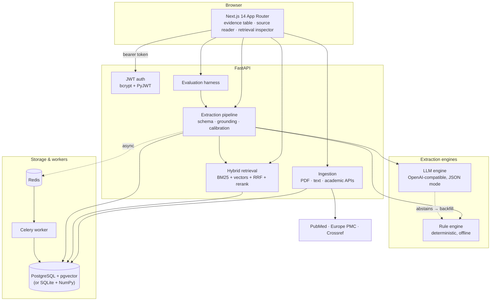
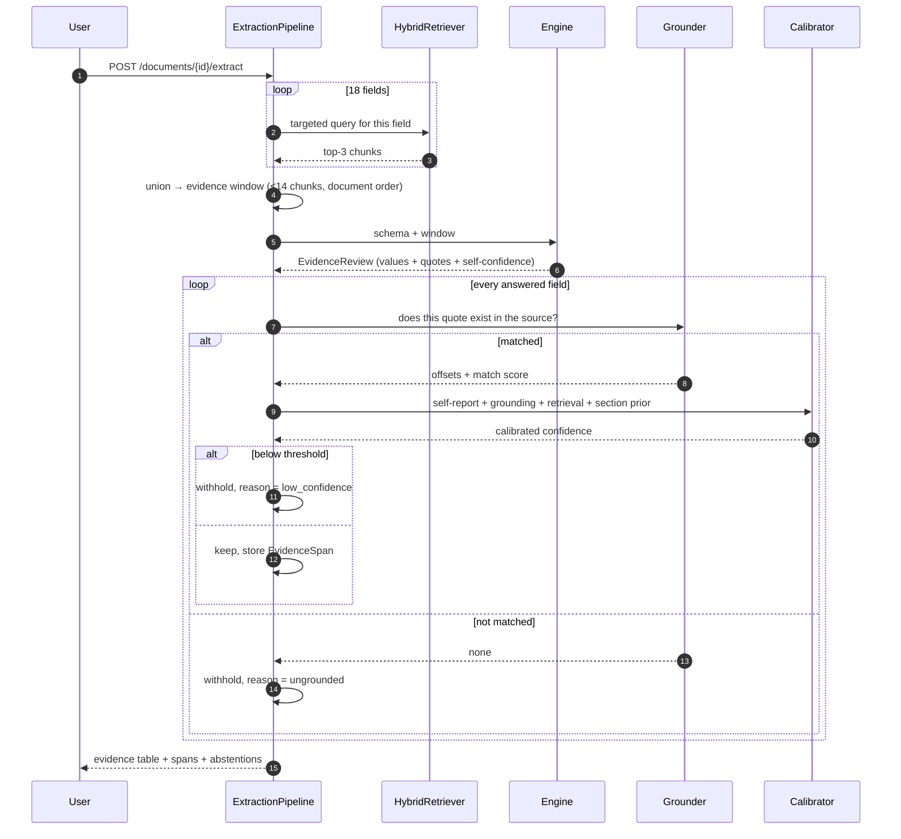
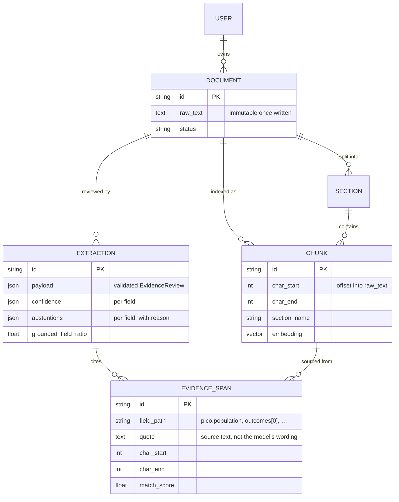

# Architecture

## System

## The extraction path, in order

## Data model

**`raw_text` is written once and never mutated.** Every section, chunk and evidence span
addresses it by character offset, so editing it in place would silently invalidate every
stored citation while leaving them all looking valid. Re-ingesting creates a new document.

## Two backends, one ORM

The only genuinely database-specific thing in the project is the embedding column, and that
difference is confined to one `TypeDecorator` (`app/db_types.py`) plus one search function
(`app/retrieval/vector_store.py`):

| | PostgreSQL | SQLite |
|---|---|---|
| Column | `vector(N)` (pgvector) | packed `float32` blob |
| Search | `<=>` cosine distance, in the database | NumPy matrix multiply |
| Scales to | large corpora, with an ivfflat/hnsw index | hundreds of chunks per document |
| Used for | Docker, deployment | development, CI, `git clone && pytest` |

Both hand Python the same `numpy.ndarray`, so no call site knows which is active.

## Abstention: every way a field can be withheld

| Reason | Meaning |
|---|---|
| `not_reported` | The engine returned `null` — the paper does not state it. |
| `no_quote` | A value with no supporting quote. Cannot be verified, so it is dropped. |
| `ungrounded` | The quote could not be matched in the source. **This is the hallucination catch.** |
| `low_confidence(0.31)` | Grounded, but the calibrated score is below `ABSTAIN_THRESHOLD`. |

All four are returned to the client in `abstentions`, so "why is sample size blank?" is
always answerable.

## Request lifecycle

1. `X-Request-ID` is assigned (or taken from the header) by middleware and echoed on the
   response, so a user-reported error can be found in the logs.
2. `get_current_user` is the only place a token becomes an identity;
   `get_owned_document` is the only place a document is loaded by id. Single-sourcing both
   is what makes the ownership guarantee auditable — no route can accidentally read another
   user's document, because no route loads documents any other way.
3. A document owned by someone else returns **404, not 403**. A 403 would confirm the id
   exists.
4. Unhandled exceptions return JSON with the request id, and the exception text only outside
   staging/production — exception messages are where connection strings end up.

## Deployment shape

`docker compose up --build` starts Postgres+pgvector, Redis, the API, a Celery worker and
the frontend. The API and the worker share one image and one codebase and differ only in
their command, which is what makes "works in the API but not in the worker" impossible.

The frontend image uses Next's `standalone` output, so the runner stage carries only the
traced server bundle rather than `node_modules`. `NEXT_PUBLIC_API_URL` is inlined at build
time, so it is a build argument rather than a runtime variable.
